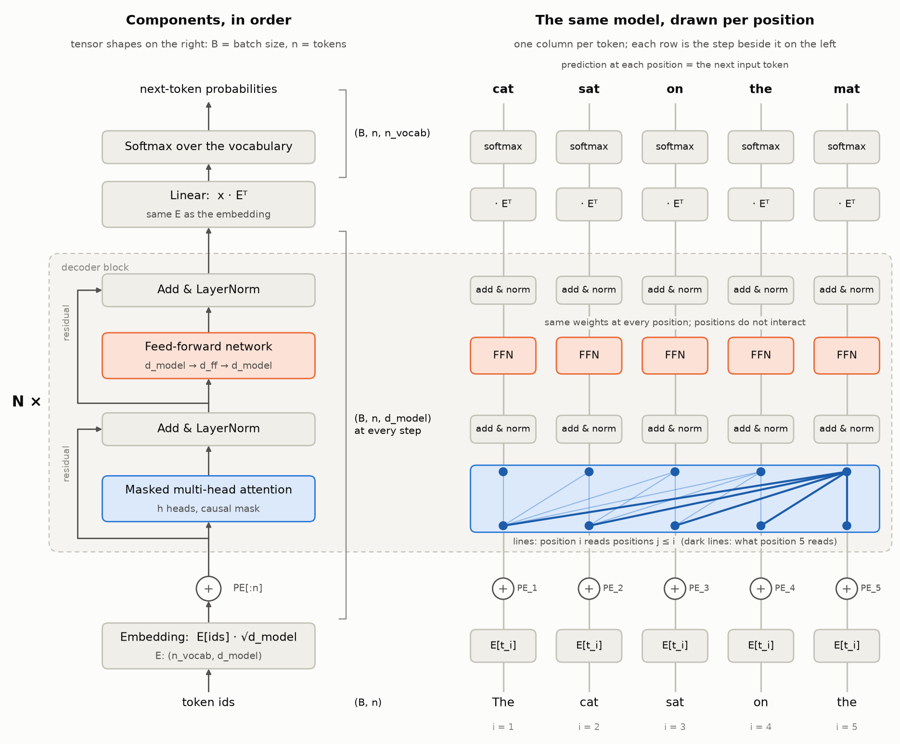
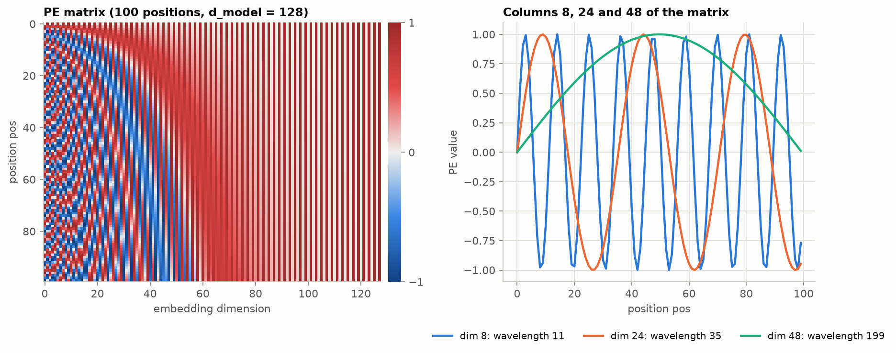
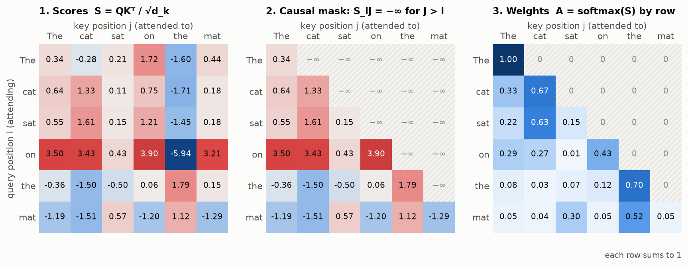
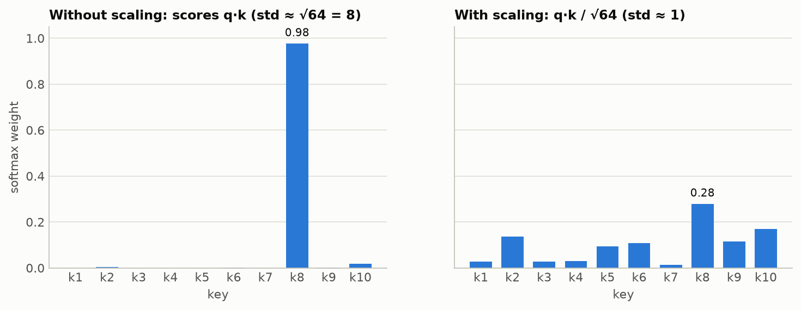
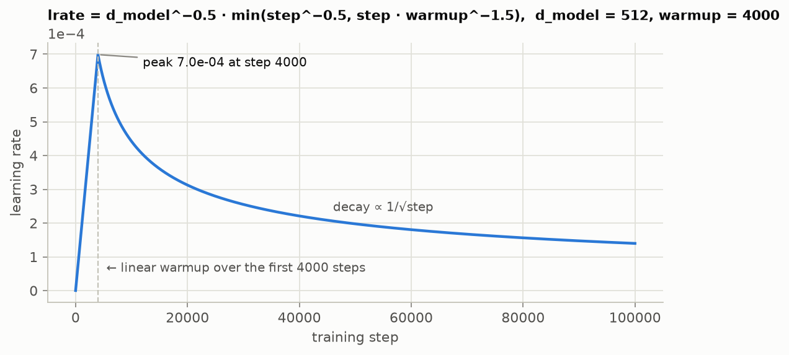

# The decoder-only Transformer from "Attention Is All You Need"

Vaswani et al. (2017) introduced the Transformer, a neural network that processes sequences using attention alone, with no recurrence. Their model was an encoder-decoder built for translation: the encoder reads the source sentence and the decoder writes the translation one token at a time. GPT-style language models use only the decoder, without the sublayer that reads from the encoder. This note derives that decoder from first principles and implements it in PyTorch with raw tensor operations. No `torch.nn` layers are used; the only library component is the `torch.optim.Adam` optimizer.

The Python blocks, run in order from the repository root, form one script. It builds the model, checks it, trains it on the text of the paper for under two minutes on a CPU, and generates text. Run it with any PyTorch 2.x install.

## 1. The task: predict the next token

A token is a unit of text, such as a character or a fragment of a word, represented by an integer id between 0 and $n_{vocab}-1$, where $n_{vocab}$ is the vocabulary size. The paper used about 37,000 word fragments. The code below uses single characters, so the vocabulary is the set of distinct characters in the paper's text.

```python
import math
import torch

torch.manual_seed(0)
text = open("papers/twelve-essential/markdown_output/1706.03762-attention-is-all-you-need.md").read()
chars = sorted(set(text))                      # the vocabulary: every distinct character
stoi = {c: i for i, c in enumerate(chars)}     # character -> token id
data = torch.tensor([stoi[c] for c in text])   # (len(text),)  the whole text as token ids
n_vocab = len(chars)                           # 105 for this text
```

A language model reads tokens $t_1, \dots, t_n$ and outputs, at every position $i$, a probability distribution over the next token, $p(t_{i+1} \mid t_1, \dots, t_i)$. A training example is a window of text. Its targets are the same window shifted left by one:

```
position i       1     2     3     4     5     6
input t_i        The   cat   sat   on    the   mat
target t_{i+1}   cat   sat   on    the   mat   .
```

The model makes all $n$ predictions in one forward pass. Training minimizes the cross-entropy loss, which is the average negative log-probability the model assigns to the correct next tokens:

$$\mathcal{L} = -\frac{1}{n}\sum_{i=1}^{n} \log p(t_{i+1} \mid t_1,\dots,t_i)$$

A model that assigns probability 1 to every correct token has loss 0. A model that guesses uniformly at random has loss $\ln n_{vocab}$, which is 4.65 for 105 characters.

Predicting every position in one pass creates one requirement. The input at position $i+1$ is the target at position $i$, so if position $i$ could read later positions, it would copy the answer. Attention is the only step in the model where positions exchange information, so the restriction is enforced there, by the causal mask (section 5).

## 2. Notation and the full model

| Symbol | Meaning | Paper (base model) | Code below |
|---|---|---|---|
| $B$ | sequences per batch | about 25,000 tokens per batch | 32 sequences |
| $n$ | tokens in a sequence | varies | at most $n_{ctx}$ |
| $n_{ctx}$ | longest sequence the code handles | no fixed limit | 64 |
| $n_{vocab}$ | vocabulary size | about 37,000 | 105 |
| $d_{model}$ | length of the vector that represents each token | 512 | 64 |
| $h$ | number of attention heads | 8 | 4 |
| $d_k = d_{model}/h$ | length of each head's query, key and value vectors (the paper's $d_k$ and $d_v$) | 64 | 16 |
| $d_{ff}$ | hidden width of the feed-forward network | 2048 | 256 |
| $N$ | number of decoder blocks | 6 | 2 |
| $p_{drop}$ | dropout rate | 0.1 | 0.1 |



*Left: the components in the order the data passes through them, with tensor shapes beside them. Each sublayer's input also skips around it (the residual connection) and is added to its output at Add & LayerNorm. Right: the same rows for the five-token input "The cat sat on the", with one column per position. Attention (blue) is the only row where positions exchange information, and each position reads only itself and earlier positions. Every other row applies the same weights to each position separately. All five positions predict their next token in the same pass.*

At the input, the vector for position $i$ describes only token $i$ and its position. After $N$ blocks, it must contain what is needed to predict token $i+1$.

The parameters, with their shapes. The paper does not specify how weights are initialized; the choice below (entries with standard deviation $1/\sqrt{\text{fan-in}}$) keeps activations near unit scale.

```python
B, n_ctx = 32, 64
d_model, h, d_ff, N = 64, 4, 256, 2
d_k = d_model // h                             # 16
p_drop = 0.1

def weight(fan_in, fan_out):                   # (fan_in, fan_out), entries with std 1/sqrt(fan_in)
    return (torch.randn(fan_in, fan_out) / math.sqrt(fan_in)).requires_grad_()

def zeros(size): return torch.zeros(size, requires_grad=True)
def ones(size):  return torch.ones(size, requires_grad=True)

params = {
    "E": (torch.randn(n_vocab, d_model) / math.sqrt(d_model)).requires_grad_(),  # (n_vocab, d_model)
    "blocks": [],
}
for _ in range(N):
    params["blocks"].append({
        "W_q": weight(d_model, d_model),       # (d_model, h*d_k): the h heads' query matrices side by side
        "W_k": weight(d_model, d_model),       # (d_model, h*d_k)
        "W_v": weight(d_model, d_model),       # (d_model, h*d_k)
        "W_o": weight(d_model, d_model),       # (h*d_k, d_model): mixes the concatenated heads
        "ln1_g": ones(d_model),  "ln1_b": zeros(d_model),   # LayerNorm after attention: gamma, beta
        "W_1": weight(d_model, d_ff), "b_1": zeros(d_ff),   # FFN layer 1: (d_model, d_ff), (d_ff,)
        "W_2": weight(d_ff, d_model), "b_2": zeros(d_model),# FFN layer 2: (d_ff, d_model), (d_model,)
        "ln2_g": ones(d_model),  "ln2_b": zeros(d_model),   # LayerNorm after FFN: gamma, beta
    })
```

## 3. Token embeddings and the output projection

The embedding matrix $E \in \mathbb{R}^{n_{vocab} \times d_{model}}$ has one row per vocabulary entry. Token id $t$ becomes a vector by taking row $t$ of $E$. The paper then multiplies by $\sqrt{d_{model}}$ without giving a reason. In this code the entries of $E$ start with standard deviation $1/\sqrt{d_{model}}$, so the multiplication brings them to standard deviation 1, the same scale as the positional encodings added next (values between −1 and 1).

At the output, the same matrix is reused, transposed. The final vector of position $i$, $x_i \in \mathbb{R}^{d_{model}}$, becomes $n_{vocab}$ scores called logits:

$$\text{logits}_i = x_i E^\top \in \mathbb{R}^{n_{vocab}}, \qquad p(t_{i+1} = v) = \frac{\exp(\text{logits}_{i,v})}{\sum_{u=1}^{n_{vocab}} \exp(\text{logits}_{i,u})}$$

The logit for token $v$ is the dot product of $x_i$ with row $v$ of $E$, so the model predicts the tokens whose embeddings point in the same direction as $x_i$. The second formula, the softmax, turns logits into positive probabilities that sum to 1. Using one matrix for both input and output (called weight tying) saves $n_{vocab} \cdot d_{model}$ parameters: 19 million at the paper's sizes, which is half the parameters of a 6-block decoder (section 12).

## 4. Positional encoding

Attention compares token vectors with dot products (section 5), and a dot product does not depend on where in the sequence its two vectors sit. Without extra information, "dog bites man" and "man bites dog" produce the same attention score between "dog" and "man". The paper fixes this by adding a vector that depends only on position, $PE_{pos} \in \mathbb{R}^{d_{model}}$, to each token vector before the first block.

The paper uses fixed sinusoids. For position $pos$ and dimension pair $i = 0, 1, \dots, d_{model}/2 - 1$:

$$PE_{pos,\,2i} = \sin(\omega_i \cdot pos), \qquad PE_{pos,\,2i+1} = \cos(\omega_i \cdot pos), \qquad \omega_i = 10000^{-2i/d_{model}}$$

Each pair of dimensions is a sine and a cosine at one frequency. The wavelength $2\pi/\omega_i$ grows geometrically from $2\pi$ (dimension 0 repeats about every 6 positions) to $10000 \cdot 2\pi$ (the last dimensions barely change over thousands of positions). Every position therefore gets a different combination of values.



*Left: each row is the vector added at one position. Right: three columns of the same matrix plotted against position. Low dimensions change fast, high dimensions change slowly.*

The authors chose sinusoids because, for any fixed offset $k$, $PE_{pos+k}$ is a linear function of $PE_{pos}$. For one pair of dimensions, by the angle-addition formulas:

$$\begin{pmatrix}\sin(\omega_i (pos+k))\\ \cos(\omega_i (pos+k))\end{pmatrix} = \begin{pmatrix}\cos \omega_i k & \sin \omega_i k\\ -\sin \omega_i k & \cos \omega_i k\end{pmatrix}\begin{pmatrix}\sin \omega_i\, pos\\ \cos \omega_i\, pos\end{pmatrix}$$

The matrix depends on the offset $k$ and not on $pos$, so one linear map turns "position $pos$" into "position $pos+k$" everywhere in the sequence. The authors expected this to make attention by relative position ("the token 3 back") easy to learn. In their experiments, learned position vectors (a trainable $n_{ctx} \times d_{model}$ matrix) gave nearly identical results. They kept sinusoids because the formula gives a vector for any position, including positions beyond the longest sequence seen in training.

```python
def sinusoidal_pe(n_ctx, d_model):
    pos = torch.arange(n_ctx).float()[:, None]               # (n_ctx, 1)          0, 1, ..., n_ctx-1
    two_i = torch.arange(0, d_model, 2).float()[None, :]     # (1, d_model/2)      0, 2, 4, ..., d_model-2
    angle = pos / 10000 ** (two_i / d_model)                 # (n_ctx, d_model/2)  pos * omega_i
    pe = torch.zeros(n_ctx, d_model)                         # (n_ctx, d_model)
    pe[:, 0::2] = torch.sin(angle)                           # even dimensions
    pe[:, 1::2] = torch.cos(angle)                           # odd dimensions
    return pe

PE = sinusoidal_pe(n_ctx, d_model)                           # (n_ctx, d_model), not trained
```

## 5. Scaled dot-product attention

### Queries, keys and values

To predict what follows "The cat sat on the", the vector at the last position needs information from earlier positions such as "sat" and "on". Attention builds each position's output as a weighted average of vectors from positions $j \le i$, with weights computed from the content of the vectors.

Three learned matrices $W_Q, W_K, W_V \in \mathbb{R}^{d_{model} \times d_k}$ map each token vector $x_j$ to three vectors of length $d_k$:

- the query $q_i = x_i W_Q$ describes what position $i$ is looking for,
- the key $k_j = x_j W_K$ describes what position $j$ offers, to be matched against queries,
- the value $v_j = x_j W_V$ is what position $j$ passes on when it is selected.

The output at position $i$ is

$$\text{out}_i = \sum_{j \le i} a_{ij}\, v_j, \qquad a_{ij} = \frac{\exp(q_i \cdot k_j / \sqrt{d_k})}{\sum_{j' \le i} \exp(q_i \cdot k_{j'} / \sqrt{d_k})}$$

The weights $a_{ij}$ are positive and sum to 1 over $j$, so $\text{out}_i$ is a weighted average of the values. The most weight goes to positions whose keys have the largest dot product with $q_i$. Queries and keys come from separate matrices because the relation is directional: a verb searching for its subject needs a different vector from the one the subject uses to be found.

### Matrix form and the causal mask

Stack the $n$ token vectors as rows of $X \in \mathbb{R}^{n \times d_{model}}$. Then $Q = XW_Q$, $K = XW_K$ and $V = XW_V$ are each $n \times d_k$, and all outputs are computed at once:

$$\text{Attention}(Q, K, V) = \text{softmax}\!\left(\frac{QK^\top}{\sqrt{d_k}} + M\right) V, \qquad M_{ij} = \begin{cases} 0 & j \le i \\ -\infty & j > i \end{cases}$$

$S = QK^\top/\sqrt{d_k}$ is an $n \times n$ matrix whose entry $S_{ij}$ scores query $i$ against key $j$. $M$ is the causal mask. Because $e^{-\infty} = 0$, every future position gets weight exactly 0 after the softmax, which is applied to each row separately. The result $A = \text{softmax}(S + M)$ is $n \times n$ and lower-triangular, and $AV$ is $n \times d_k$.



*The three steps for a six-token sequence, computed with random weights (so the numbers carry no linguistic meaning). Row $i$ of panel 3 holds the weights position $i$ uses to average the values. The first position can see only itself, so its weight on itself is 1.*

### Why the scores are divided by $\sqrt{d_k}$

Suppose the entries of $q$ and $k$ are independent with mean 0 and variance 1. Then $q \cdot k = \sum_{m=1}^{d_k} q_m k_m$ is a sum of $d_k$ terms, each with variance 1, so it has variance $d_k$ and standard deviation $\sqrt{d_k}$, which is 8 for $d_k = 64$. Scores spread over a range of about ±16 make the softmax put almost all weight on the largest score. The softmax then stops learning: the derivative of output $a_i$ with respect to score $s_j$ is $a_i(\delta_{ij} - a_j)$, where $\delta_{ij}$ is 1 if $i = j$ and 0 otherwise, and this is close to 0 for every $i, j$ when $a$ is close to one-hot. Dividing by $\sqrt{d_k}$ brings the variance back to 1.



*One random query against ten random keys, $d_k = 64$. Unscaled, one key takes 98% of the weight. Scaled, the weights stay spread out and gradients flow to every key.*

```python
def attention(q, k, v, mask):
    # q, k, v: (B, h, n, d_k)    mask: (n, n) bool, True where key j <= query i
    scores = q @ k.transpose(-2, -1) / math.sqrt(q.shape[-1])    # (B, h, n, n)   S
    scores = scores.masked_fill(~mask, float("-inf"))            # (B, h, n, n)   S + M
    weights = torch.softmax(scores, dim=-1)                      # (B, h, n, n)   A, each row sums to 1
    return weights @ v                                           # (B, h, n, d_k)
```

## 6. Multi-head attention

One attention gives each position one weighted average. If position $i$ needs two different things at once, such as the previous token and the subject of the sentence, a single set of weights has to blend them. Multi-head attention runs $h$ attentions in parallel, each with its own $W_Q^{(r)}, W_K^{(r)}, W_V^{(r)} \in \mathbb{R}^{d_{model} \times d_k}$, concatenates their outputs, and mixes them with $W_O \in \mathbb{R}^{h d_k \times d_{model}}$:

$$\text{head}_r = \text{Attention}(XW_Q^{(r)},\ XW_K^{(r)},\ XW_V^{(r)}) \in \mathbb{R}^{n \times d_k}, \qquad r = 1, \dots, h$$

$$\text{MultiHead}(X) = \text{Concat}(\text{head}_1, \dots, \text{head}_h)\, W_O \in \mathbb{R}^{n \times d_{model}}$$

Because $d_k = d_{model}/h$, the $h$ heads together cost about the same as one head of width $d_{model}$. In the paper's trained translation model, different heads learned different jobs. In its Figure 4, two heads appear to work out which noun the pronoun "its" refers to ("Law", in "The Law will never be perfect, but its application should be just"). In its experiments, 1 head was clearly worse than 8, 16 heads matched 8, and 32 were slightly worse.

Placing the $h$ matrices $W_Q^{(r)}$ side by side gives one $d_{model} \times d_{model}$ matrix, so a single matrix multiplication computes every head's queries. A reshape then separates the heads:

```
x                              (B, n, d_model)      d_model = h · d_k
x @ W_q                        (B, n, d_model)      all h heads' queries side by side
  .view(B, n, h, d_k)          (B, n, h, d_k)       cut the last axis into h slices of width d_k
  .transpose(1, 2)             (B, h, n, d_k)       heads become a batch axis
attention(q, k, v, mask)       (B, h, n, d_k)       h independent attentions in one call
  .transpose(1, 2)             (B, n, h, d_k)
  .reshape(B, n, d_model)      (B, n, d_model)      concatenate the heads
  @ W_o                        (B, n, d_model)      mix the heads
```

```python
def multi_head_attention(x, blk, mask):
    B, n, _ = x.shape                                        # x: (B, n, d_model)
    def split_heads(t):                                      # (B, n, d_model) -> (B, h, n, d_k)
        return t.view(B, n, h, d_k).transpose(1, 2)
    q = split_heads(x @ blk["W_q"])                          # (B, h, n, d_k)
    k = split_heads(x @ blk["W_k"])                          # (B, h, n, d_k)
    v = split_heads(x @ blk["W_v"])                          # (B, h, n, d_k)
    heads = attention(q, k, v, mask)                         # (B, h, n, d_k)
    concat = heads.transpose(1, 2).reshape(B, n, d_model)    # (B, n, h*d_k) = (B, n, d_model)
    return concat @ blk["W_o"]                               # (B, n, d_model)
```

## 7. Position-wise feed-forward network

After attention has moved information between positions, the feed-forward network (FFN) processes each position's vector separately, with the same two-layer network at every position:

$$\text{FFN}(x) = \max(0,\ xW_1 + b_1)\, W_2 + b_2$$

Here $W_1 \in \mathbb{R}^{d_{model} \times d_{ff}}$, $b_1 \in \mathbb{R}^{d_{ff}}$, $W_2 \in \mathbb{R}^{d_{ff} \times d_{model}}$, $b_2 \in \mathbb{R}^{d_{model}}$, and $\max(0, \cdot)$, called ReLU, is applied to each entry. Applied to the $n \times d_{model}$ matrix of all positions, the matrix product transforms every row with the same weights, and no row affects another. With $d_{ff} = 4 d_{model}$, the FFN holds $2 d_{model} d_{ff} = 8 d_{model}^2$ weights per block, twice the $4 d_{model}^2$ of the attention matrices.

```python
def ffn(x, blk):
    hidden = torch.relu(x @ blk["W_1"] + blk["b_1"])         # (B, n, d_ff)
    return hidden @ blk["W_2"] + blk["b_2"]                  # (B, n, d_model)
```

## 8. Residual connections, layer normalization and dropout

Each sublayer (attention or FFN) is wrapped the same way:

$$x \leftarrow \text{LayerNorm}\big(x + \text{Dropout}(\text{Sublayer}(x))\big)$$

The residual connection adds the sublayer's output to its input, so the sublayer only has to compute a change to $x$. It also gives the gradient a direct path: $\partial(x + f(x))/\partial x = I + \partial f/\partial x$, so the gradient reaches early blocks through the identity term $I$ even when $\partial f/\partial x$ is small. The addition requires every sublayer to output vectors of length $d_{model}$, which is why $d_{model}$ is the same throughout the model.

Layer normalization rescales each position's vector to mean 0 and variance 1 across its $d_{model}$ entries, then applies a learned scale $\gamma \in \mathbb{R}^{d_{model}}$ and shift $\beta \in \mathbb{R}^{d_{model}}$:

$$\text{LayerNorm}(x) = \gamma \odot \frac{x - \mu}{\sqrt{\sigma^2 + \epsilon}} + \beta, \qquad \mu = \frac{1}{d_{model}}\sum_{m=1}^{d_{model}} x_m, \qquad \sigma^2 = \frac{1}{d_{model}}\sum_{m=1}^{d_{model}} (x_m - \mu)^2$$

$\odot$ is entry-by-entry multiplication, and $\epsilon = 10^{-6}$ prevents division by zero. Without the normalization, each residual addition could change the scale of $x$, and the scale would drift over $2N$ additions.

Dropout is used only during training. It sets each entry to 0 with probability $p_{drop}$ and multiplies the remaining entries by $1/(1 - p_{drop})$, so the expected value of each entry is unchanged. Because any activation can disappear, the network cannot depend on a single one, which reduces overfitting. The paper applies dropout to each sublayer's output before the residual addition, and to the sum of embeddings and positional encodings. Removing it made the paper's model clearly worse.

```python
def layer_norm(x, g, b, eps=1e-6):
    mean = x.mean(-1, keepdim=True)                          # (B, n, 1)  mu for each position
    var = ((x - mean) ** 2).mean(-1, keepdim=True)           # (B, n, 1)  sigma^2 for each position
    return g * (x - mean) / torch.sqrt(var + eps) + b        # (B, n, d_model)


def dropout(x, train):
    if not train:
        return x
    keep = (torch.rand_like(x) > p_drop).float()             # same shape as x: 1 = keep, 0 = drop
    return x * keep / (1 - p_drop)


def decoder_block(x, blk, mask, train):
    a = multi_head_attention(x, blk, mask)                                   # (B, n, d_model)
    x = layer_norm(x + dropout(a, train), blk["ln1_g"], blk["ln1_b"])         # (B, n, d_model)
    f = ffn(x, blk)                                                          # (B, n, d_model)
    x = layer_norm(x + dropout(f, train), blk["ln2_g"], blk["ln2_b"])         # (B, n, d_model)
    return x
```

## 9. The full forward pass

```python
def forward(params, ids, train=False):
    n = ids.shape[1]                                         # ids: (B, n) token ids
    x = params["E"][ids] * math.sqrt(d_model)                # (B, n, d_model)  embedding lookup
    x = dropout(x + PE[:n], train)                           # (B, n, d_model)  add position
    mask = torch.tril(torch.ones(n, n, dtype=torch.bool))    # (n, n)  True on and below the diagonal
    for blk in params["blocks"]:
        x = decoder_block(x, blk, mask, train)               # (B, n, d_model)
    return x @ params["E"].T                                 # (B, n, n_vocab)  logits
```

The mask can be tested directly. Change the token at Python index 10 of a sequence: the outputs at indices 0 to 9 must stay exactly the same, and the outputs from index 10 on must change. If the mask were removed, the first assertion would fail.

```python
ids = torch.randint(0, n_vocab, (1, 16))                     # (1, 16) a random sequence
ids_changed = ids.clone()
ids_changed[0, 10] = (ids[0, 10] + 1) % n_vocab
out, out_changed = forward(params, ids), forward(params, ids_changed)   # each (1, 16, n_vocab)
assert torch.allclose(out[0, :10], out_changed[0, :10])      # earlier positions cannot see index 10
assert not torch.allclose(out[0, 10:], out_changed[0, 10:])  # index 10 and later can
```

## 10. Training

### Loss with label smoothing

The paper trains against a smoothed target. Instead of probability 1 on the correct token, the target puts $1 - \epsilon_{ls}$ on it and spreads $\epsilon_{ls} = 0.1$ evenly over all $n_{vocab}$ tokens. The cross-entropy against that target, for one position with correct token $t$, is

$$\ell = (1 - \epsilon_{ls})\,\big(-\log p_t\big) + \epsilon_{ls} \cdot \frac{1}{n_{vocab}}\sum_{v=1}^{n_{vocab}} \big(-\log p_v\big)$$

The second term penalizes any token with probability near 0, so the model learns to be less certain. The paper reports that this made the loss on held-out text worse but improved translation accuracy.

### Optimizer and learning-rate schedule

The paper uses Adam with $\beta_1 = 0.9$, $\beta_2 = 0.98$ and $\epsilon = 10^{-9}$, and sets the learning rate at every step:

$$\text{lrate} = d_{model}^{-0.5} \cdot \min\!\big(\text{step}^{-0.5},\ \text{step} \cdot \text{warmup}^{-1.5}\big)$$



*The rate rises linearly for `warmup` steps, then falls in proportion to $1/\sqrt{\text{step}}$. The paper used warmup = 4000.*

The paper gives no reason for the warmup. Later work (Xiong et al., 2020) showed that Transformers with layer normalization placed after the residual addition, as here, often fail to train if they start at the full learning rate. The paper's base model trained for 100,000 steps, about 12 hours on 8 NVIDIA P100 GPUs. The toy run below uses 2,000 steps, so its warmup is shortened to 200.

```python
def loss_fn(logits, targets, eps_ls=0.1):
    # logits: (B, n, n_vocab)    targets: (B, n) token ids
    logp = torch.log_softmax(logits, dim=-1)                 # (B, n, n_vocab)  log p for every token
    nll = -logp.gather(-1, targets[..., None]).squeeze(-1)   # (B, n)  -log p(correct token)
    smooth = -logp.mean(-1)                                  # (B, n)  mean of -log p over the vocabulary
    return ((1 - eps_ls) * nll + eps_ls * smooth).mean()     # scalar


def lrate(step, warmup):
    return d_model ** -0.5 * min(step ** -0.5, step * warmup ** -1.5)


all_tensors = [params["E"]] + [t for blk in params["blocks"] for t in blk.values()]
opt = torch.optim.Adam(all_tensors, betas=(0.9, 0.98), eps=1e-9)
steps, warmup = 2000, 200

for step in range(1, steps + 1):
    for group in opt.param_groups:
        group["lr"] = lrate(step, warmup)
    start = torch.randint(0, len(data) - n_ctx - 1, (B,))             # (B,) random window starts
    x = torch.stack([data[s : s + n_ctx] for s in start])             # (B, n_ctx) inputs
    y = torch.stack([data[s + 1 : s + n_ctx + 1] for s in start])     # (B, n_ctx) targets, shifted by one
    loss = loss_fn(forward(params, x, train=True), y)
    opt.zero_grad()
    loss.backward()
    opt.step()
    if step == 1 or step % 500 == 0:
        with torch.no_grad():                                # plain cross-entropy, no dropout
            ce = loss_fn(forward(params, x), y, eps_ls=0.0).item()
        print(f"step {step:5d}   cross-entropy {ce:.2f}")
```

Output:

```
step     1   cross-entropy 5.31
step   500   cross-entropy 1.78
step  1000   cross-entropy 1.44
step  1500   cross-entropy 1.31
step  2000   cross-entropy 1.26
```

Guessing uniformly among the 105 characters gives a cross-entropy of 4.65. The first value is higher because the randomly initialized model assigns uneven probabilities. The final value of 1.26 means the model gives the correct next character a probability of $e^{-1.26} \approx 0.28$ on average (geometric mean). These numbers are measured on training batches, and the run makes about 4 million predictions on a 47,000-character text, so part of the drop is memorization; unseen text would score worse.

## 11. Generating text

Generation repeats one step: run the model on the tokens so far, take the probability distribution at the last position, draw a token from it, and append that token to the input.

```python
@torch.no_grad()
def generate(params, ids, new_tokens):
    for _ in range(new_tokens):                              # ids: (1, n) the text so far
        logits = forward(params, ids[:, -n_ctx:])            # (1, n, n_vocab), at most n_ctx positions
        probs = torch.softmax(logits[:, -1], dim=-1)         # (1, n_vocab)  distribution for the next token
        next_id = torch.multinomial(probs, 1)                # (1, 1)  draw one token
        ids = torch.cat([ids, next_id], dim=1)               # (1, n+1)
    return ids

prompt = torch.tensor([[stoi[c] for c in "The Transformer "]])       # (1, 16)
print("".join(chars[i] for i in generate(params, prompt, 300)[0].tolist()))
```

The first lines of one sample (sampling is random, so other runs differ):

```
The Transformer and on two tProjjultiply between it 6 ConvS2J English Zhit Ishngle Dot-to-ther.
Fot the Transformer sequential for of the convolutionality at droput bather in queried in varise
```

The model has learned the spelling of frequent words and phrases from the paper, such as "the Transformer", "sequential" and "English", but not grammar. Two blocks of width 64 trained for 2,000 steps on one paper are enough to show that the mechanism learns, not to produce fluent text.

This loop recomputes every earlier position at each step. Because of the causal mask, the keys and values of earlier positions never change when a token is appended, so production systems store them between steps (a "KV cache") and compute only the new position.

## 12. Cost

### Compared with recurrent networks

Before the Transformer, language models were mostly recurrent networks, which read tokens one at a time and update a hidden state $h_t = f(h_{t-1}, x_t)$. The paper's Table 1 compares one layer of each, with $d = d_{model}$:

| Layer | Computation per layer | Steps that must run one after another | Longest path between two positions |
|---|---|---|---|
| Self-attention | $O(n^2 \cdot d)$ | $O(1)$ | $O(1)$ |
| Recurrent | $O(n \cdot d^2)$ | $O(n)$ | $O(n)$ |

```
Recurrent:       x1 ──► h1 ──► h2 ──► h3 ──► ··· ──► hn
                 n steps, each waits for the previous one; x1 reaches hn after n−1 steps

Self-attention:  every position i reads every position j ≤ i directly, all positions at once
                 x1 reaches position n in one step
```

The second column explains the training speed. A recurrent network must process $n$ positions in sequence; attention processes them all with a few large matrix multiplications, which GPUs run efficiently. The third column measures how many steps a signal travels between two positions. The paper argues that shorter paths make dependencies between distant tokens easier to learn.

The first column is the price. The score matrix $QK^\top$ has $n^2$ entries per head per layer, so doubling the context length quadruples the attention computation and the memory for scores. Self-attention is cheaper than recurrence when $n < d$, which held for the paper's sentences. For long contexts the $n^2$ term dominates the cost.

### Parameter count

Per block, the attention matrices hold $4 d_{model}^2$ weights, the FFN holds $2 d_{model} d_{ff} + d_{ff} + d_{model}$, and the two layer normalizations hold $4 d_{model}$. With $d_{ff} = 4 d_{model}$, one block has about $12 d_{model}^2$ parameters, so the whole model has about

$$n_{vocab} \cdot d_{model} + 12\, N\, d_{model}^2$$

At the paper's base sizes that is $18.9\text{M} + 18.9\text{M} \approx 38\text{M}$ for a decoder-only model. The same formula applies to much larger models: GPT-3 ($N = 96$, $d_{model} = 12288$) gives $12 \cdot 96 \cdot 12288^2 \approx 174$ billion from the blocks, close to its published 175 billion.

```python
n_params = sum(t.numel() for t in all_tensors)
expected = n_vocab * d_model + N * (4 * d_model**2 + 2 * d_model * d_ff + d_ff + d_model + 4 * d_model)
assert n_params == expected
print(f"{n_params:,} parameters")
```
