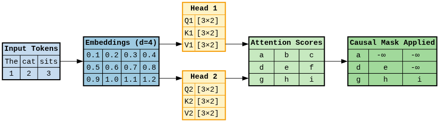

**Reference**: https://www.kapilsharma.dev/posts/kv-caching-visualized/

KV caching exploits the **block lower-triangular structure of causal self-attention** so that autoregressive decoding reuses previously computed Key and Value matrices instead of recomputing them at every step. Mathematically, this reduces total attention-block compute over $N$ generated tokens from $O(N^3 d + N^2 d^2)$ to $O(N^2 d + N d^2)$, trading compute for $O(N)$ memory storage.

## 1. Causal Self-Attention Setup

Consider a single attention head processing a sequence of $t$ tokens represented as row vectors stacked in $X_t \in \mathbb{R}^{t \times d}$, where $d$ is the model dimension. Learned weight matrices $W_Q, W_K, W_V \in \mathbb{R}^{d \times d_k}$ project the sequence into queries, keys, and values:

$$Q_t = X_t W_Q, \qquad K_t = X_t W_K, \qquad V_t = X_t W_V \qquad \in \mathbb{R}^{t \times d_k}$$

Causal self-attention computes the output $O_t \in \mathbb{R}^{t \times d_k}$ as:

$$O_t = \text{softmax}\!\left(\frac{Q_t K_t^\top + M_t}{\sqrt{d_k}}\right) V_t$$

where the **causal mask** $M_t \in \mathbb{R}^{t \times t}$ prevents any token from attending to future tokens:

$$(M_t)_{ij} = \begin{cases} 0 & \text{if } i \ge j \\ -\infty & \text{if } i \lt j \end{cases}$$

---

Notice in the diagram below how each token's embedding row maps to a corresponding row in $Q$, $K$, and $V$, and how the causal mask replaces every entry above the main diagonal of the attention score matrix with $-\infty$:

---

## 2. The Block-Matrix Proof

Suppose the model has already processed tokens $1, \dots, t-1$ and just generated token $t$ with hidden state row vector $x_t \in \mathbb{R}^{1 \times d}$. Partition the updated input matrix by separating the past prefix from the single new row:

$$X_t = \begin{bmatrix} X_{t-1} \\ x_t \end{bmatrix}$$

Because matrix multiplication acts independently on each row, the projections partition identically:

$$Q_t = \begin{bmatrix} X_{t-1} W_Q \\ x_t W_Q \end{bmatrix} = \begin{bmatrix} Q_{t-1} \\ q_t \end{bmatrix}, \qquad K_t = \begin{bmatrix} K_{t-1} \\ k_t \end{bmatrix}, \qquad V_t = \begin{bmatrix} V_{t-1} \\ v_t \end{bmatrix}$$

where $q_t, k_t, v_t \in \mathbb{R}^{1 \times d_k}$ are single row vectors for token $t$.

Now expand the masked score matrix $Q_t K_t^\top + M_t$ in block form:

$$Q_t K_t^\top + M_t = \begin{bmatrix} Q_{t-1} \\ q_t \end{bmatrix} \begin{bmatrix} K_{t-1}^\top & k_t^\top \end{bmatrix} + \begin{bmatrix} M_{t-1} & -\infty \\ \mathbf{0} & 0 \end{bmatrix} = \begin{bmatrix} Q_{t-1} K_{t-1}^\top + M_{t-1} & -\infty \\ q_t K_{t-1}^\top & q_t k_t^\top \end{bmatrix}$$

Apply row-wise softmax. Because $\exp(-\infty) = 0$, the upper-right block vanishes completely, leaving the attention weight matrix $A_t \in \mathbb{R}^{t \times t}$ in block lower-triangular form:

$$A_t = \begin{bmatrix} A_{t-1} & \mathbf{0} \\ \alpha_t^{(1:t-1)} & \alpha_t^{(t)} \end{bmatrix} = \begin{bmatrix} A_{t-1} & \mathbf{0} \\ \alpha_t \end{bmatrix}$$

where $\alpha_t = \text{softmax}\!\left(\frac{q_t K_t^\top}{\sqrt{d_k}}\right) \in \mathbb{R}^{1 \times t}$ is the attention distribution for token $t$ alone.

Finally, multiply $A_t$ by $V_t$:

$$O_t = A_t V_t = \begin{bmatrix} A_{t-1} & \mathbf{0} \\ \alpha_t^{(1:t-1)} & \alpha_t^{(t)} \end{bmatrix} \begin{bmatrix} V_{t-1} \\ v_t \end{bmatrix} = \begin{bmatrix} A_{t-1} V_{t-1} \\ \alpha_t V_t \end{bmatrix} = \begin{bmatrix} O_{t-1} \\ o_t \end{bmatrix}$$

This single block identity establishes the two mathematical facts that make KV caching exact—not an approximation:

* **Causal invariance of past states:** The first $t-1$ rows of $O_t$ equal $O_{t-1}$ exactly. Because layer norms, residual connections, and feed-forward networks also operate independently per token row, induction across every layer $\ell$ guarantees that $X_{t-1}^{(\ell)}$—and therefore $K_{t-1}^{(\ell)}$ and $V_{t-1}^{(\ell)}$—never change as new tokens arrive.
* **Why we cache $K$ and $V$, but never $Q$:** Predicting token $t+1$ depends only on the final row $o_t = \alpha_t V_t$. Inspecting its inputs shows that $o_t$ requires only the new query $q_t$, paired with the full history of keys $K_t$ and values $V_t$. Past queries $Q_{t-1}$ only affect $O_{t-1}$, which is discarded.

## 3. The Cached Decode Algorithm

Inference splits into two mathematically distinct regimes:

1. **Prefill (prompt length $P$):** Compute $Q_P, K_P, V_P$ for all prompt tokens in parallel using matrix-matrix multiplication, then store $(K_P, V_P)$ in memory for each layer.
2. **Decode (step $t \gt P$):** Given only the single new row $x_t \in \mathbb{R}^{1 \times d}$:
* **Project one token:** $q_t = x_t W_Q$, $k_t = x_t W_K$, $v_t = x_t W_V$.
* **Append to cache:** $K_t \leftarrow \begin{bmatrix} K_{t-1} \\ k_t \end{bmatrix}$ and $V_t \leftarrow \begin{bmatrix} V_{t-1} \\ v_t \end{bmatrix}$.
* **Vector-matrix attention:** Compute $o_t = \text{softmax}\!\left(\frac{q_t K_t^\top}{\sqrt{d_k}}\right) V_t$.

## 4. Complexity vs. Memory Trade-Off

Consider a multi-head transformer with $L$ layers, hidden dimension $d = H_q d_k$ across $H_q$ query heads, and $H_{kv}$ key-value heads ($d_{kv} = H_{kv} d_k$, where $H_{kv} = H_q$ for standard Multi-Head Attention and $H_{kv} \lt H_q$ for Grouped-Query Attention). Counting 2 FLOPs per multiply-add for the attention block ($Q, K, V, O$ projections plus $QK^\top$ and $AV$):

| Quantity | Without KV Cache | With KV Cache | Reduction |
| --- | --- | --- | --- |
| **Projections at step $t$ (per layer)** | $4 t d (d + d_{kv})$ | $4 d (d + d_{kv})$ | $t\times$ |
| **Attention $QK^\top, AV$ at step $t$ (per layer)** | $4 t^2 d$ | $4 t d$ | $t\times$ |
| **Total over $N$ steps ($L$ layers)** | $L\left[2d(d+d_{kv})N(N+1) + \frac{2}{3}dN(N+1)(2N+1)\right]$ | $L\left[4d(d+d_{kv})N + 2dN(N+1)\right]$ | $O(N)\times$ |
| **Asymptotic total FLOPs** | $O(L(N^3 d + N^2 d^2))$ | $O(L(N^2 d + N d^2))$ | One power of $N$ |

The identities $\sum_{t=1}^{N} t = \frac{N(N+1)}{2}$ and $\sum_{t=1}^{N} t^2 = \frac{N(N+1)(2N+1)}{6}$ explain why uncached generation explodes cubically with sequence length $N$, whereas cached generation stays quadratic in $N$.

### The Memory Cost

Storing $K_t$ and $V_t$ across all $L$ layers for batch size $B$, sequence length $S$, and $b$ bytes per element (e.g., $b = 2$ for BF16/FP16) requires:

$$\text{Memory}_{\text{KV}} = \underbrace{2}_{K \text{ and } V} \cdot B \cdot L \cdot H_{kv} \cdot d_k \cdot S \cdot b \quad \text{bytes}$$

For a Llama-3-8B-scale model ($L = 32$, $H_{kv} = 8$, $d_k = 128$, $b = 2$, $B = 1$):

$$\text{Memory per token} = 2 \times 32 \times 8 \times 128 \times 2 = 131{,}072 \text{ bytes} = 128\text{ KiB/token}$$

At $S = 8{,}192$ tokens, the cache holds $1\text{ GiB}$ per sequence; at $S = 131{,}072$ ($128\text{K}$) tokens, it reaches $16\text{ GiB}$—exceeding the weights of an 8B FP16 model. Furthermore, replacing matrix-matrix operations ($t \times d$) with vector-matrix operations ($1 \times d$) drops arithmetic intensity sharply, turning decoding from **compute-bound** to **memory-bandwidth-bound** as GPUs stream the growing $K_t$ and $V_t$ tensors from memory on every token.
